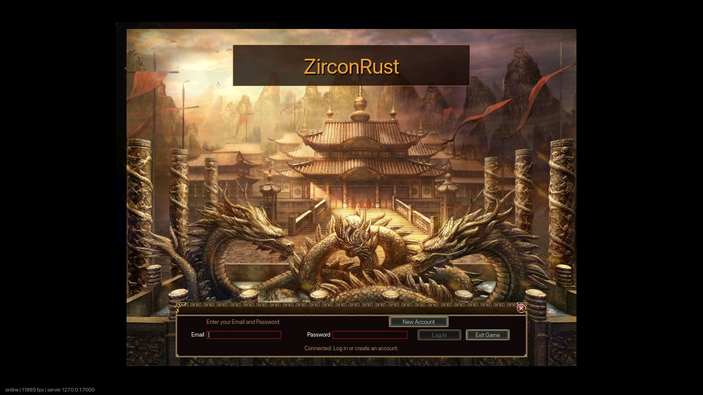
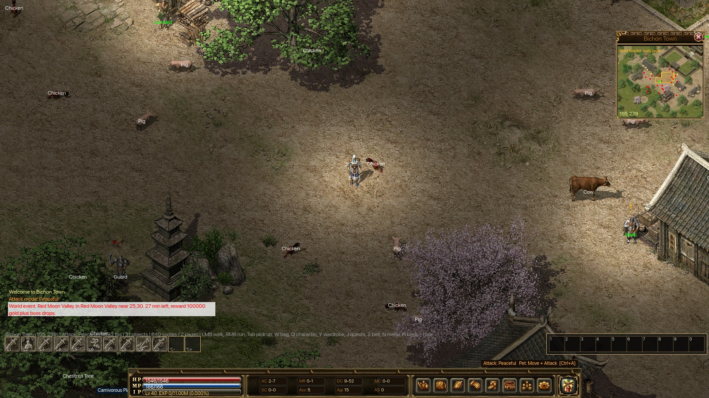
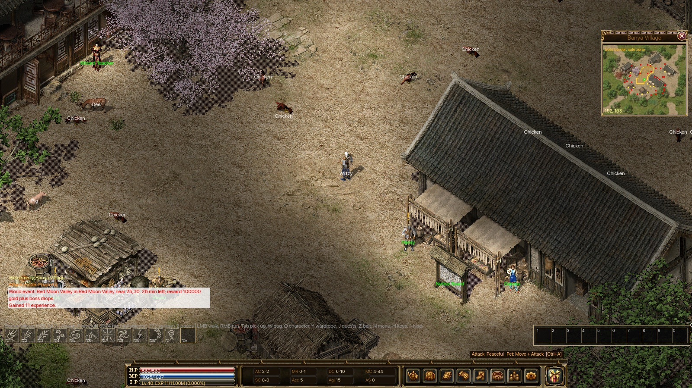
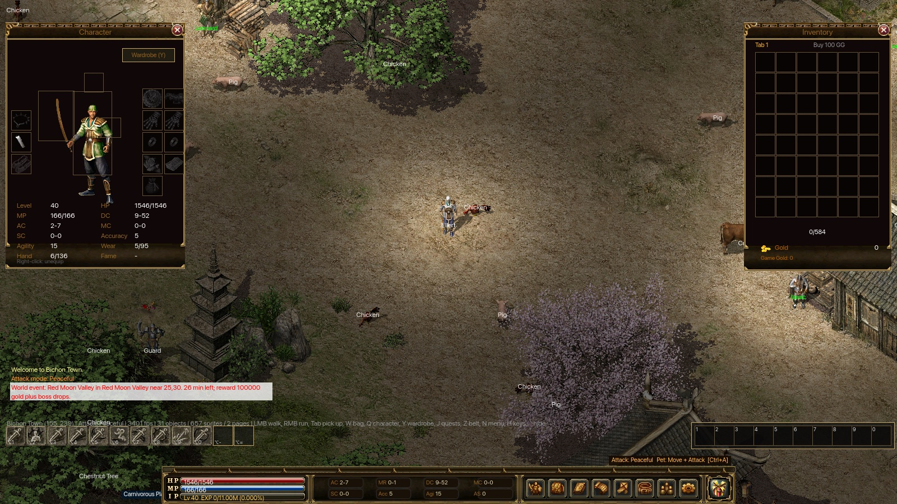

# Rebuilding Legend of Mir 3 in Rust: From Zircon to ZirconRust

I played Legend of Mir 3 in the early 2000s. It had dark 2D towns and
crowded spawn rooms, and on siege nights whole guilds threw themselves at
Sabuk Wall. <!-- TODO(author): add a personal memory here: your server,
your class, a night you remember. --> Twenty years later the game still
exists, kept alive by a community C# project called **Zircon**. This post
is about rewriting that project in Rust as **ZirconRust**: a new client and
a new server that read the original game files, look like Mir 3, and run
natively on macOS, Windows and Linux.

Below I walk through why I picked Rust, why my first port failed, what I
did differently the second time, and what Rust actually changed. It is aimed at developers and at
anyone who spent too many hours in Bichon.

**Key Takeaways**

- Porting a game file by file never gave me something I could run.
  Building a new client and server around the original asset formats did,
  and I could play it from the first milestone.
- ZirconRust has five crates and about 110,000 lines of Rust. There is a
  separate server, a native wgpu client, and a data editor that writes the
  original files back byte for byte.
- I chose Rust for one language across client, server and protocol, native
  graphics on three operating systems, and a compiler strict enough to
  catch AI agents' mistakes early.
- The C# code stays untouched and serves as the specification. When the
  two disagree, the C# code wins, not its comments.
- AI does more than write the code. One MCP server lets an AI host run live
  events as a game master, and another builds playable maps from a
  one-line brief without touching the installed game files.
- A screenshot at every step, plus more than 500 tests on three operating systems,
  kept a fast rewrite honest.



## What Zircon is

Zircon is the open-source Legend of Mir 3 server and client, written in C#
and published by the Mir community. The main repository,
[Suprcode/Zircon](https://github.com/Suprcode/Zircon), dates from February
2019 and had 474 stars and 351 forks when I looked
([GitHub API](https://api.github.com/repos/Suprcode/Zircon), retrieved
2026-09-30). Its README points to the LOMCN forum, where most private-server
discussion happens.

The game underneath is WeMade's Legend of Mir 3. It was the sequel to Legend
of Mir 2, which Wikipedia calls the most popular MMORPG in China in 2002 and
2003, with more than 250,000 simultaneous users
([Wikipedia: The Legend of Mir 2](https://en.wikipedia.org/wiki/The_Legend_of_Mir_2),
retrieved 2026-09-30). Mir 3 moved to 16-bit colour and, according to
Wikipedia, peaked at 750,000 concurrent users
([Wikipedia: The Legend of Mir 3](https://en.wikipedia.org/wiki/The_Legend_of_Mir_3),
retrieved 2026-09-30).

Zircon is Windows-only on the client side because it draws with DirectX. A
Zircon install has three parts I care about:

- `.Zl` sprite libraries holding every character, monster, spell and
  interface image
- `.map` files: grids of 48×32 pixel cells, each with three tile layers
  and walk flags
- `System.db`, a binary database of every item, monster, NPC, spell and
  quest, written by Zircon's own ORM (MirDB)

This is what a Sabuk Wall siege looked like. It is the reason any of this
exists:

<div class="video-embed">
  <iframe
    width="560" height="315"
    title="Sabuk Wall Siege (apexguild)"
    aria-label="YouTube video: Sabuk Wall Siege, a Legend of Mir 3 castle siege, by apexguild"
    loading="lazy"
    src="https://www.youtube-nocookie.com/embed/_geowvmGFpY"
    srcdoc="<style>*{padding:0;margin:0;overflow:hidden}html,body{height:100%}img,span{position:absolute;width:100%;top:0;bottom:0;margin:auto}span{height:1.5em;text-align:center;font:48px/1.5 sans-serif;color:white;text-shadow:0 0 0.5em black}</style><a href=https://www.youtube-nocookie.com/embed/_geowvmGFpY?autoplay=1><span>▶</span></a>"
    frameborder="0"
    allow="accelerometer; autoplay; encrypted-media; gyroscope; picture-in-picture"
    allowfullscreen></iframe>
  <noscript><a href="https://www.youtube.com/watch?v=_geowvmGFpY">Watch "Sabuk Wall Siege" by apexguild on YouTube</a></noscript>
</div>

## Why Rust, and not C# or anything else

Rust fit the goal: one native client for macOS, Windows and Linux, and a
server I could put on a cheap Linux box and trust with traffic from
strangers. <!-- TODO(author): check these reasons are yours, and add any
personal ones. --> The options I weighed:

- **Staying in C#.** Zircon's client is tied to Windows through DirectX and
  WinForms. Modern .NET runs on every platform, but making this client
  cross-platform would mean replacing its rendering, windowing, audio and
  UI layers. That is most of a client, so it is a rewrite either way, just
  one that keeps the old structure. The C# server already runs on Linux, and
  keeping it was a real option. Owning both ends instead let me design the
  protocol, the data loading and the tests together.
- **A game engine (Godot, Unity, Bevy).** Mir 3 is a fixed-order 2D sprite
  renderer on a cell grid, not a scene graph. An engine brings an editor,
  a runtime and its own ideas about scenes and input that the game does
  not need. Zircon-Godot shows that route works; I wanted a smaller stack
  that I understand end to end.
- **C++.** Close to the original games and fast, but a network server in
  C++ makes memory safety my job in every file.
- **Go or Java.** Both are good for servers, but neither has a mature,
  portable GPU stack for the client, so I would still need a second
  language on that side.

What Rust gave in return:

- **One language on both sides.** `mir-proto` holds the messages and the
  shared game rules, so the client and server compile against the same
  types. If one side changes a message, the other side stops compiling.
- **Native graphics on every platform.** wgpu targets Metal, Direct3D 12 and
  Vulkan from one code base, and winit handles the window.
- **No garbage-collector pauses** in a game loop, and a single static binary
  for the server that fits in a small Docker image.
- **A compiler that checks the agents.** Most of the code was written with
  AI agents. Rust's type checker and borrow checker, plus `clippy
  -D warnings` in CI, reject a lot of plausible-looking mistakes before any
  test runs. That mattered more than raw speed.

## Why the first port failed

My first attempt translated the C# into Rust one piece at a time. It had a
Bevy client, a Tokio server and a Tauri admin tool. After about 18,000
lines it still was not playable, and what it did draw looked wrong.

<!-- [PERSONAL EXPERIENCE] -->
That approach went wrong in a way I think is common. Every translated piece
compiled and passed its tests, but nothing connected end to end. I had no
screen to look at, so I only found out the rendering was wrong once enough
parts were in place to see it, and by then it was badly wrong. The branch
also broke the C# build it was supposed to leave alone. I deleted it.

The lesson I took: **a port is only real once you can play it.** Translating
code preserves its structure, and Zircon's structure was designed around
WinForms, DirectX and a single Windows process. Those are exactly the parts
a Rust rewrite should not copy.

## What the second attempt did differently

The second attempt started from the data, not the code. The rules I set on
day one:

1. **Never edit the C# projects.** They are the reference for file formats
   and game rules, nothing more.
2. **Read the original assets directly.** No export step, no JSON copy of
   `System.db`. The Rust server opens the MirDB binary at startup.
3. **Purpose-built client and server** with their own protocol, rather
   than a copy of Zircon's packet layout.
4. **Something visible at every step.** The first milestone was a real map
   from real `.map` and `.Zl` files, a warrior you click to move, monsters
   from the real spawn tables, melee combat, death and respawn, and two
   clients that can see each other.



The formats turned out to be small. A `.Zl` library is a header followed by
DXT1 or DXT5 compressed images, each with a draw offset and an optional
shadow. A `.map` file is a grid of 14-byte cell records. MirDB is harder
because it stores whole object graphs, but its layout is regular once you
have read the C# serializer. In `mir-formats` all three readers share one
primitive, a little-endian cursor over a byte slice:

```rust
/// Width of one map cell in pixels.
pub const CELL_WIDTH: i32 = 48;
/// Height of one map cell in pixels.
pub const CELL_HEIGHT: i32 = 32;

/// Little-endian cursor over a byte slice, the only primitive the readers need.
pub(crate) struct Cursor<'a> {
    data: &'a [u8],
    pos: usize,
}
```

<!-- [UNIQUE INSIGHT] -->
Later I added writers for the same formats. The data editor saves `.map` and
`System.db` files that are **byte-identical** to the originals when nothing
has changed, and a test checks this against the shipped files. That
round-trip test is the best evidence I have that the readers really
understand the formats, as opposed to just being good enough to draw a
picture.

## Five crates, one workspace

ZirconRust is a Cargo workspace of five crates:

| Crate | Role |
|---|---|
| `mir-formats` | Readers and writers for `.Zl`, `.map` and MirDB, plus DXT1/DXT5 codecs |
| `mir-proto` | Client/server messages, encoded with postcard and a length prefix |
| `mir-server` | Tokio server: accounts, maps, spawns, combat, monster AI, magic, quests, guilds |
| `mir-client` | Native client built on winit and wgpu, with a custom sprite batch |
| `mir-editor` | egui editor for `System.db`, maps and sprites |

<!-- [ORIGINAL DATA] -->
<figure>
  <svg viewBox="0 0 560 270" role="img" aria-labelledby="loc-title loc-desc" xmlns="http://www.w3.org/2000/svg" style="max-width:100%;height:auto;font-family:system-ui,sans-serif">
    <title id="loc-title">Lines of Rust per ZirconRust crate</title>
    <desc id="loc-desc">Horizontal bar chart. mir-server 49,140 lines; mir-editor 27,201; mir-client 25,843; mir-formats 4,314; mir-proto 3,011. Total 109,509.</desc>
    <text x="10" y="24" fill="currentColor" font-size="15" font-weight="600">Lines of Rust per crate (total 109,509)</text>
    <g font-size="13" fill="currentColor">
      <text x="10" y="67">mir-server</text>
      <rect x="120" y="50" width="360" height="24" rx="3" fill="#d97706"/>
      <text x="486" y="67">49,140</text>
      <text x="10" y="107">mir-editor</text>
      <rect x="120" y="90" width="199" height="24" rx="3" fill="#2563eb"/>
      <text x="325" y="107">27,201</text>
      <text x="10" y="147">mir-client</text>
      <rect x="120" y="130" width="189" height="24" rx="3" fill="#2563eb"/>
      <text x="315" y="147">25,843</text>
      <text x="10" y="187">mir-formats</text>
      <rect x="120" y="170" width="32" height="24" rx="3" fill="#2563eb"/>
      <text x="158" y="187">4,314</text>
      <text x="10" y="227">mir-proto</text>
      <rect x="120" y="210" width="22" height="24" rx="3" fill="#2563eb"/>
      <text x="148" y="227">3,011</text>
    </g>
  </svg>
  <figcaption>Source: line counts of <code>*.rs</code> files in the ZirconRust workspace, 2026-09-30.</figcaption>
</figure>

The server is the biggest crate because that is where the game lives. It
holds the whole player spell list of about 174 spells, monster AI profiles,
bosses, quests, NPC scripts (including Lua page scripts through `mlua`),
groups, guilds, trading, mail, a marketplace, mounts, fishing and mining,
and the Sabuk Wall conquest. Rules that both sides need, such as Zircon's move
and attack timings, attack speed and spell cost and power formulas, live in
`mir_proto::rules`, so the client and server cannot drift apart on them.

The client uses [wgpu](https://crates.io/crates/wgpu) 30 for rendering and
[winit](https://crates.io/crates/winit) for windowing. It deliberately does
not use a game engine. Mir 3 is a flat 2D grid of 48×32 cells with 8-way
movement, drawn in a fixed layer order, with the UI on top. A sprite batch
that knows that order was simpler than bending an engine
to match it. The interface is built from the original interface sprites, so
the game still looks like Mir 3.

## Playable at every step

I made "can I see it?" the definition of done. Every milestone ended with
a screenshot taken by the client itself.
`ZIRCON_SCREENSHOT=out.png:5 cargo run -p mir-client` saves a frame after
five seconds, and `ZIRCON_HEADLESS=1` renders offscreen so it also works on
a locked Mac. More environment switches log in, create a character, open
windows, cast spells or talk to an NPC, so one command reaches almost any
screen. The screenshots in this post were all made that way.

<!-- [ORIGINAL DATA] -->
<figure>
  <svg viewBox="0 0 560 290" role="img" aria-labelledby="cm-title cm-desc" xmlns="http://www.w3.org/2000/svg" style="max-width:100%;height:auto;font-family:system-ui,sans-serif">
    <title id="cm-title">Commits per day in the first five days of ZirconRust</title>
    <desc id="cm-desc">Lollipop chart of commits touching the rust directory: 10 September 2026, 1; 11 September, 5; 12 September, 23; 13 September, 23; 14 September, 26. 78 commits in total.</desc>
    <text x="10" y="24" fill="currentColor" font-size="15" font-weight="600">Commits per day, first five days (78 total)</text>
    <line x1="40" y1="230" x2="530" y2="230" stroke="currentColor" stroke-opacity="0.4"/>
    <g stroke="#d97706" stroke-width="3">
      <line x1="80" y1="230" x2="80" y2="223.5"/>
      <line x1="180" y1="230" x2="180" y2="197.3"/>
      <line x1="280" y1="230" x2="280" y2="79.6"/>
      <line x1="380" y1="230" x2="380" y2="79.6"/>
      <line x1="480" y1="230" x2="480" y2="60"/>
    </g>
    <g fill="#d97706">
      <circle cx="80" cy="223.5" r="7"/>
      <circle cx="180" cy="197.3" r="7"/>
      <circle cx="280" cy="79.6" r="7"/>
      <circle cx="380" cy="79.6" r="7"/>
      <circle cx="480" cy="60" r="7"/>
    </g>
    <g font-size="13" fill="currentColor" text-anchor="middle">
      <text x="80" y="208">1</text>
      <text x="180" y="182">5</text>
      <text x="280" y="64">23</text>
      <text x="380" y="64">23</text>
      <text x="480" y="45">26</text>
      <text x="80" y="252">10 Sep</text>
      <text x="180" y="252">11 Sep</text>
      <text x="280" y="252">12 Sep</text>
      <text x="380" y="252">13 Sep</text>
      <text x="480" y="252">14 Sep</text>
    </g>
  </svg>
  <figcaption>Source: <code>git log</code> of the <code>rust/</code> directory, 10–14 September 2026.</figcaption>
</figure>

<!-- [PERSONAL EXPERIENCE] -->
The pace came from working with two AI coding agents, Anthropic's Claude
Code and OpenAI's Codex. <!-- TODO(author): say how you split work between
Claude and Codex, if you want to. --> Independent systems such as horses
and marriage, fishing and mining, refining and companions, or guilds and
mail went to parallel agents, each in its own git worktree, and
I merged their branches in order. The merge conflicts almost always landed
in the same few shared places: protocol enums, the player record, the main
dispatch `match`, and key-binding tables. That told me where the code was
coupled more than any architecture diagram did.



Staying playable also meant writing down where the Rust port chose to
differ from Zircon, and why. For example, Zircon potions heal instantly, not
over time, and its marketplace charges no listing fee, only a 7% tax on
sales. When the C# code and its comments disagree, the code wins. When the
asset pack has no data for a feature (this pack has no loot-box or bundle
tables), the feature is left out rather than invented.

## Letting AI run events and build maps

Using AI to write the code was only the first step. ZirconRust also lets an
AI work inside the game, through two local
[Model Context Protocol](https://modelcontextprotocol.io/) (MCP) servers
that any MCP host, such as Claude Code or Codex, can launch.

### An AI game master for live events

`mir-game-mcp` logs in to a running server as a game-master character and
gives the AI two tools:

- **`gm_command`** runs any existing GM command, such as `@monster` to spawn
  a boss, `@move` to set up the arena, `@make gold 100000` to hand out a
  reward, or `@startconquest` to open a Sabuk Wall siege.
- **`log_tail`** reads the last lines of the server log, so the AI can see
  what actually happened.

That is enough for an AI to host an event: pick a map, spawn the boss,
announce it, watch the log and pay out the winners. <!-- TODO(author): add
an event the AI actually ran, and how players reacted. --> The server keeps
control. GM rights are stored on the character on the server side, so no
client can grant them to itself, and the AI can only use commands a human
GM could also type. The same server has a `triage_issue` prompt that turns
a player's bug report into log reading, a reproduction and a GitHub issue.
It says to treat logs and chat as untrusted evidence, and not to run
state-changing commands without permission.

These AI-run events sit on top of the scheduled ones. Every two hours (UTC)
the server rotates in a boss hunt from the original event tables, with a
100,000 gold reward. That is the red "World event" line in the screenshots.

### An MCP server that builds maps

The data editor has a second mode, `mir-editor --mcp`, that exposes map and
database authoring as tools. `map_inspect`, `map_copy_area`, `map_stamp`
and `map_collision` edit maps cell by cell. `world_generate`,
`world_branch` and `world_populate` build whole playable areas with walls,
a safe zone, portals and monster spawns. The shortest path is a single
call:

```json
{
  "name": "world_from_brief",
  "arguments": {
    "brief": "six-room Wood dungeon with chickens",
    "output": "chicken-world",
    "seed": 42
  }
}
```

That returns a playable map, a database revision and any private wall art
it generated. For richer requests, a `create_world` prompt tells the
host's AI to search the installed content, choose a generator, call the
tools, inspect the result and report back. The editor never calls an AI
provider itself. The AI lives in the host, and the editor only provides
checked tools.

<!-- [UNIQUE INSIGHT] -->
The design rule that made this safe to hand to an AI: **every edit writes a
new revision directory.** The installed assets, the source `System.db` and
earlier revisions are never modified, and the authoring server has no
network listener and no connection to a live game server. A request that
fails validation, such as a blocked portal or an unknown monster, writes
nothing. An AI can try ten dungeon layouts, and a human decides which one
ships.

## What Rust actually changed

Rust mostly changed how confident I could be when changing things, rather
than how fast the game runs.

- **Determinism.** The server uses a seeded RNG (`ZIRCON_SEED`) and ordered
  maps for world objects, so a test replays the same fight every time. Two
  tests that were flaky because of `HashMap` iteration order became stable
  once their helpers picked the lowest index instead of the first one found.
- **Tests without ceremony.** The workspace has more than 500 tests,
  from DXT block decoding up to a load test that starts the real server
  binary and connects twelve bots. CI runs `fmt`, `clippy -D warnings`,
  build and test on Linux, macOS and Windows, and builds the server Docker
  image.
- **One language, three platforms.** The same client builds as a macOS
  `.app`, a Windows binary and a Linux binary. The server ships as a
  container with the assets mounted as a volume.
- **Memory safety as a default, not a project.** Google reported that memory
  safety bugs fell from 76% of Android vulnerabilities in 2019 to an
  expected 24% by the end of 2024, mainly because new code was written in
  memory-safe languages such as Rust
  ([The Register](https://www.theregister.com/2024/09/25/google_rust_safe_code_android/),
  25 September 2024). For a game server that accepts packets from strangers,
  that default is worth having. In ZirconRust it sits alongside explicit
  limits: bounded queues, flood and idle checks, and a maximum number of
  packets per tick.



## Where this goes next

<!-- TODO(author): confirm plans and add anything you want to call out. -->
The planned scope (content, then the missing systems, then multiplayer
hardening) is done. What remains is mostly polish and tooling. The editor
is growing into a place to make new sprites and maps, and a VPS deployment
guide covers running a public server. There are other rewrites too:
[Zircon-Godot](https://github.com/iamcheyan/Zircon-Godot) keeps the C#
server rules and rebuilds the client in Godot. ZirconRust made the opposite
choice and rebuilt both sides, keeping only the data.

For the original game in motion,
[MMOHuts' Legend of Mir 3 first look](https://www.youtube.com/watch?v=DDDHK14QjIk)
is a good reference for how the Rust client should feel.

## Frequently asked questions

### Does ZirconRust include the game assets?

No. The `.Zl`, `.map` and `System.db` files are not in the repository. You
extract them from a Zircon client package and point `ZIRCON_ASSETS` and
`ZIRCON_DB` at them. The sprites in this post come from that asset pack.

### Can the Rust client connect to a Zircon C# server?

No. ZirconRust uses its own protocol (postcard-encoded messages defined in
`mir-proto`), so the Rust client needs the Rust server. Both must be built
from the same commit.

### Why not use Bevy or another game engine?

The first attempt used Bevy and never became playable. Mir 3 needs a fixed
draw order over a 2D cell grid, and a custom wgpu sprite batch does that in
far less code than adapting an engine.

## Conclusion

Rebuilding Legend of Mir 3 in Rust worked once I stopped translating code
and started from the data. The summary:

- Treat the original C# as a specification, not source to convert.
- Read the original asset formats directly, and prove it with byte-identical
  round-trips.
- Define "done" as a screenshot of the running game.
- Use deterministic tests and CI on every platform to keep speed from
  turning into breakage.

<!-- TODO(author): closing line about getting back to Sabuk Wall. -->
If you played Mir 3 back then, the towns look the way you remember. If you
are thinking about porting an old game of your own, start with its data
files.
